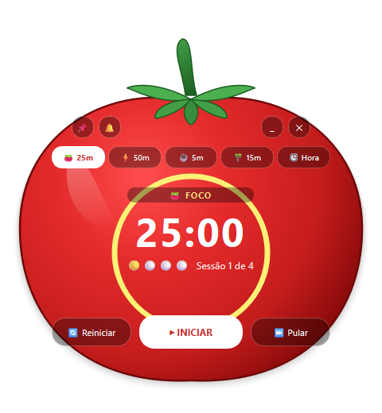

# Pomodoro Relógio ⏰🍅

Uma aplicação moderna de **Pomodoro e Relógio Digital** desenvolvida em **Python** com **PySide6**.
Com design exclusivo em **formato de tomate**, janela translúcida e flutuante na área de trabalho, ícones dedicados e botões altamente intuitivos.

<p align="center">
  
</p>

---

## ✨ Principais Novidades & Melhorias

- 🍅 **Janela em Formato Real de Tomate**: Interface translúcida e sem bordas (*frameless*), renderizada vetorialmente com sombreamento 3D, talo verde e cálice orgânico.
- 🖼️ **Ícone Dedicado de Tomate**: Arquivos `.ico` e `.png` em alta definição, configurados inclusive na barra de tarefas do Windows (`AppUserModelID`).
- 🖱️ **Arraste Livre**: Clique e arraste em qualquer parte do corpo do tomate para posicioná-lo onde desejar na tela.
- 🎯 **Botões Altamente Intuitivos**:
  - **Cápsulas de Modo Rápidas**: `🍅 25m` (Foco), `⚡ 50m` (Foco Intenso), `☕ 5m` (Pausa Curta), `🌴 15m` (Pausa Longa) e `🕒 Hora` (Modo Relógio).
  - **Controles de Reprodução**:
    - `▶ INICIAR` / `⏸ PAUSAR` / `▶ CONTINUAR` (botão central com feedback visual instantâneo).
    - `🔄 Reiniciar` (recomeça a contagem do modo ativo).
    - `⏭ Pular` (avança automaticamente para a próxima fase do ciclo).
- ⭕ **Anel de Progresso Circular**: Indicador visual dinâmico que desenha um arco em tempo real acompanhando o tempo restante.
- 🍅 **Contador de Ciclos Pomodoro**: Marcador visual de sessões concluídas (`🍅 🍅 ⚪ ⚪ • Sessão 2 de 4`).
- 📌 **Fixar no Topo (*Always on Top*)**: Botão de alfinete para manter o tomate sempre visível por cima de navegadores, IDEs e editores de texto.
- 🔔 **Alerta Sonoro**: Aviso sonoro com melodia agradável em thread secundária ao término da sessão (com botão para silenciar a qualquer momento).
- 📋 **Menu de Contexto**: Clique com o botão direito para acessar atalhos rápidos de modos, fixação e saída.

---

## 🧠 Como Funciona o Ciclo Pomodoro

1. Escolha uma sessão de foco (`25 min` ou `50 min`) e clique em **INICIAR**.
2. O anel circular esvazia suavemente conforme os minutos passam.
3. Ao zerar o cronômetro, um aviso sonoro suave toca e o aplicativo sugere ou avança para a pausa merecida (`5 min`).
4. A cada 4 ciclos de foco completados, o sistema sugere uma pausa longa (`15 min`).
5. Você também pode ativar o modo **Relógio Digital** a qualquer momento para utilizá-lo como widget de mesa.

---

## 🛠️ Tecnologias Utilizadas

- **Python 3**
- **PySide6** (Qt 6 para Python)
- **QPainter & QPainterPath** para desenho vetorial de formas suaves e gradientes 3D
- **QTimer** para controle preciso do tempo
- **Threading & winsound** para notificações sonoras assíncronas

---

## ▶️ Como Executar

### 1. Clonar o repositório
```bash
git clone https://github.com/Thalesvictorvieira/Pomodoro-Relogio.git
cd Pomodoro-Relogio
```

### 2. Ativar o ambiente virtual (ou instalar o PySide6)
```bash
# No Windows:
.\.venv\Scripts\activate

# Caso precise instalar a dependência:
pip install PySide6
```

### 3. Iniciar o aplicativo
```bash
python RELOGIOPOMO.py
```
